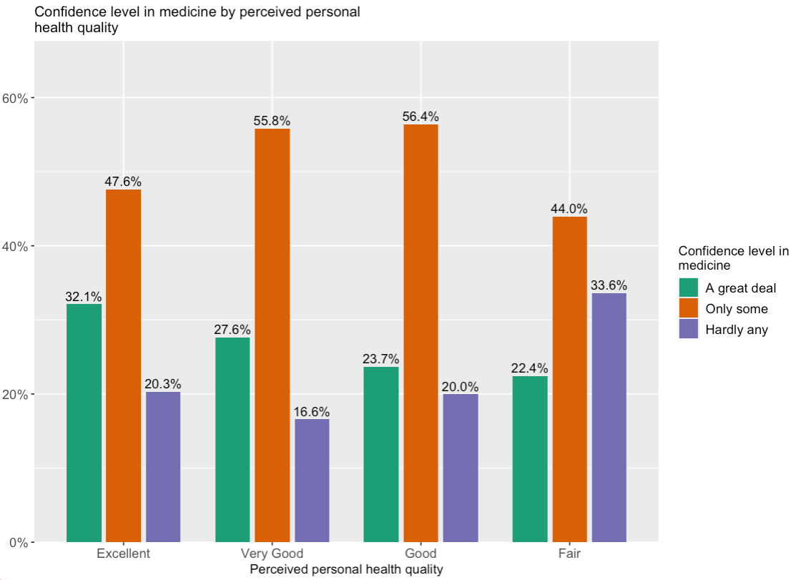

# Module items  { data-readaloud-exclude }
## R Script file code { data-readaloud-exclude }
- :lucide-clipboard-copy: [[Copy the code]] below ➜ Paste into [[RStudio console]] ➜ Hit ++enter++  
    - ```r
    source(url("https://raw.githubusercontent.com/ttezcann/ssric-reg/refs/heads/main/docs/assets/attachments/data/0-packages-data.R")); 
    (function(f="09-visualization.R"){if(!file.exists(f)){download.file("https://raw.githubusercontent.com/ttezcann/ssric-reg/refs/heads/main/docs/assets/attachments/modules/09.-visualization/09-visualization.R",f,mode="wb");file.edit(f)}else{download.file("https://raw.githubusercontent.com/ttezcann/ssric-reg/refs/heads/main/docs/assets/attachments/modules/09.-visualization/09-visualization.R",gsub(".R","-original.R",f),mode="wb");file.edit(gsub(".R","-original.R",f))}})()
    ```
        - When this R script file opens in a new tab, [[Save R script file|save your previous R script file(s)]], and 
            - Close the previous tabs (R Script files), which you can find later in the [[Files tab]].

## Lab assignment  { data-readaloud-exclude }
[Visualization :lucide-download:](https://github.com/ttezcann/ssric-reg/raw/refs/heads/main/docs/assets/attachments/modules/09.-visualization/09-visualization.docx){ .md-button .md-button--primary }

### Sample lab assignment  { data-readaloud-exclude }
[Sample: Visualization :lucide-download:](https://github.com/ttezcann/ssric-reg/raw/refs/heads/main/docs/assets/attachments/modules/09.-visualization/09.1-sample-visualizations.docx){ .md-button .md-button--primary }

## Suggested reading  { data-readaloud-exclude }
<div class="grid cards" markdown>
- :lucide-book-open:  
Healy, Kieran Joseph. 2019. “Look at the Data.” Pp. 1–23 in Data visualization: A practical introduction. Princeton: Princeton University Press.
</div>

<!-- slide-break -->
## Learning outcomes
1. Learn how to generate and interpret a stacked bar graph for multiple categorical variables
2. Learn how to generate and interpret a grouped bar graph
3. Learn how to customize graph appearance by modifying color themes, titles, and font sizes 
<!-- slide-break -->
# [[Stacked bar graph for multiple variables]]
- A stacked bar graph for multiple variables displays:
    - Multiple [[categorical]] variables with the exact same response categories at the same time.
        - Each row represents one variable and shows the percentage breakdown across response categories.
        - It is useful when you want to compare distributions across several related variables.
        - When interpreting stacked bar graphs, we generally interpret one response category.
- We will create a stacked bar graph for confidence in major US institutions variables, then interpret it.
<!-- slide-break -->
## Find the variables in Variables in GSS page
1. We want to make sure all selected variables are categorical.
2. [[Search]] the variable names, `conbus`, `coneduc`, `confed`, `conmedic`, `conarmy`, and `conjudge` in [Variables in GSS](../resources/variables-in-gss.md){: target="_blank"} page.
    - | Variable name | Variable label | Variable type | Question wording and response categories |
    |---|---|---|---|
    | `conbus` | Confidence level in major companies | Ordinal | Would you say you have confidence in major companies?<br>*(1: A great deal; 2: Only some; 3: Hardly any)* |
    | `coneduc` | Confidence level in education | Ordinal | Would you say you have confidence in education?<br>*(1: A great deal; 2: Only some; 3: Hardly any)* |
    | `confed` | Confidence level in executive branch of fed. govt. | Ordinal | Would you say you have confidence in executive branch of the federal government?<br>*(1: A great deal; 2: Only some; 3: Hardly any)* |
    | `conmedic` | Confidence level in medicine | Ordinal | Would you say you have confidence in medicine?<br>*(1: A great deal; 2: Only some; 3: Hardly any)* |
    | `conarmy` | Confidence level in military | Ordinal | Would you say you have confidence in military?<br>*(1: A great deal; 2: Only some; 3: Hardly any)* |
    | `conjudge` | Confidence level in United States Supreme Court | Ordinal | Would you say you have confidence in Supreme Court?<br>*(1: A great deal; 2: Only some; 3: Hardly any)* |
<!-- slide-break -->
## [[Stacked bar graph for multiple variables]] #code
- **[[Model code]]**
    - ```r linenums="1"  hl_lines="2 4 6 7 8 9"
    graph <- gss |> 
    select(variable1_here, variable2_here, variable3_here) |>
    plot_stackfrq(sort.frq = "first.asc",  geom.colors = "Blues",
    show.total = FALSE, title = "title_here")
    graph + theme(
    axis.text.x = element_text(size=11),
    axis.text.y = element_text(size=11),
    plot.title = element_text(size=12),
    legend.text = element_text(size=11))
    ```
- **[[Working code]]**
    - ```r linenums="1"  hl_lines="2 4 6 7 8 9"
    graph <- gss |> 
    select(conbus, coneduc, confed, conmedic, conarmy, conjudge) |> 
    plot_stackfrq(sort.frq = "first.asc",  geom.colors = "Blues",
    show.total = FALSE, title = "Confidence in major US institutions")
    graph + theme(
    axis.text.x = element_text(size=11),
    axis.text.y = element_text(size=11),
    plot.title = element_text(size=12),
    legend.text = element_text(size=11))
    ```
        - **Line 2:** We put the variable names here ➜ `variable1_here, variable2_here, variable3_here`, separated by a comma. 
            - `conbus`, `coneduc`, `confed`, `conmedic`, `conarmy`, `conjudge`.
        - **Line 4:** We put the graph title here ➜ `title_here` ➜ `Confidence in major US institutions`.
        - **Line 6:** Change font size of x-axis labels ➜ size=`11`
        - **Line 7:** Change font size of y-axis labels ➜ size=`11`
        - **Line 8:** Change font size of graph title ➜ size=`12`
        - **Line 9:** Change font size of legend ➜ size=`11`
            - [[Find this working code in the R script file]].
                - [[Highlighting and running]] this code will generate the output below (which will appear in the [[plots tab]] of RStudio).
<!-- slide-break -->
## [[Stacked bar graph for multiple variables]] #output
- 
<!-- slide-break -->
## [[Stacked bar graph for multiple variables]] #interpretation
- !!! note "Stacked bar graph for multiple variables interpretation sample"
    Of the GSS respondents, **40.8%** have a **great deal** of confidence in the **military**; **27.2%** have a great deal of confidence in **medicine**; **19.6%** in **education**; **16.4%** in the **supreme court**; **14.4%** in **major companies**; and **12.5%** in the **executive branch of government**.
- !!! quote "Stacked bar graph for multiple variables interpretation template"
    Of the GSS respondents, **xx.xx%** have / report / say **[[value label]]** in **[[variable label]] 1**; **xx.xx%** have / report / say **value label** in **variable label 2**; **xx.xx%** have / report / say **value label** in **variable label 3**...
- !!! success "Interpretation explanation"
    - When interpreting stacked bar graphs, we pick **one response category**, use the percentage shown on the graph, and compare it across all variables.
        - In this example, we interpret the "**a great deal**" category (light blue).
        - Then, we report the percentage for the same response category in each variable by tweaking wording to make it understandable. That's why we always read the [[question wording]] first.
            - For example: "40.8% have a great deal of **confidence** in the military..."
<!-- slide-break -->
# [[Grouped bar graph]]
- We can create a grouped bar graph to:
    - Compare a [[categorical]] variable's distribution across groups.
- We will create a stacked bar graph for confidence in medicine by perceived health groups.
    - Since we use two variables, we want to see the connection between the two variables. Therefore, we need to decide which one is the [[factor variable]], and which one is the [[outcome variable]].
        - ```mermaid
        flowchart LR
            subgraph F["Factor variable (Categorical)"]
                A[Perceived personal health quality<br/>1: Excellent;<br/> 2: Very good;<br/> 3: Good; <br/> 4: Fair; <br/> 5: Poor]
            end
    
            subgraph O["Outcome variable (Categorical)"]
                B[Confidence level in medicine<br/>1: A great deal;<br/> 2: Only some;<br/> 3: Hardly any]
            end
    
            A ==>|May have an effect on| B
        ```
<!-- slide-break -->
## Find the variables in Variables in GSS page
1. We want to make sure all selected variables are categorical.
2. We check this information in the [Variables in GSS](../resources/variables-in-gss.md){: target="_blank"} page.
    - | Variable name | Variable label | Variable type | Question wording and response categories |
      |---|---|---|---|
      | `health` | Perceived personal health quality | Ordinal | Would you say that in general your health is Excellent, Very good, Good, Fair, or Poor?<br>*(1: Excellent; 2: Very Good; 3: Good; 4: Fair; 5: Poor)* |
      | `conmedic` | Confidence level in medicine | Ordinal | Would you say you have confidence in medicine?<br> *(1: A great deal; 2: Only some; 3: Hardly any)* |
<!-- slide-break -->
## [[Grouped bar graph]] #code
- **[[Model code]]**
    - ```r linenums="1"  hl_lines="2 4 6 7 8 9"
    graph <- plot_xtab(
    gss$factor_here, gss$outcome_here, show.n = FALSE, margin = "row",
    geom.colors = "Dark2",
    show.total = FALSE, title = "title_here")
    graph + theme(
    axis.text.x = element_text(size = 11),
    axis.text.y = element_text(size = 11),
    plot.title = element_text(size = 12),
    legend.text = element_text(size = 11))
    ```
- **[[Working code]]**
    - ```r linenums="1"  hl_lines="2 4 6 7 8 9"
    graph <- plot_xtab(
    gss$health, gss$conmedic, show.n = FALSE, margin = "row",
    geom.colors = "Dark2",
    show.total = FALSE, title = "Confidence level in medicine by perceived personal health quality")
    graph + theme(
    axis.text.x = element_text(size = 11),
    axis.text.y = element_text(size = 11),
    plot.title = element_text(size = 12),
    legend.text = element_text(size = 11))
    ```
        - **Line 2:** We put `health` here ➜ `factor_here`, and `conmedic` here ➜ `outcome_here`.
        - **Line 4:** We put the graph title here ➜ `title_here` ➜ `Confidence level in medicine by perceived personal health quality`.
        - **Line 6:** Change font size of x-axis labels ➜ size=`11`
        - **Line 7:** Change font size of y-axis labels ➜ size=`11`
        - **Line 8:** Change font size of graph title ➜ size=`12`
        - **Line 9:** Change font size of legend ➜ size=`11`
            - Now, [[find this working code in the R script file]], and 
                - [[Highlighting and running|Highlight and run]] the working code in this module's R script file to generate the output shown below, which will appear in the [[viewer tab]] of RStudio.
<!-- slide-break -->
## [[Grouped bar graph]] #output
- 
<!-- slide-break -->
## [[Grouped bar graph]] #interpretation
- !!! note "Grouped bar graph interpretation sample"
    Of the GSS respondents who perceive their health as **excellent**, **20.3%** have **hardly any** **confidence in medicine**, **47.6%** have **only some** confidence, and **32.1%** have **a great deal** of confidence.
- !!! quote "Grouped bar graph interpretation template"
    Of the GSS respondents who are / have / feel / perceive / think / say / report **selected [[value label]]** of the **[[factor variable]]**, **xx.x%** are / have / feel / perceive / think / say / report **value label 1** of the **[[outcome variable]]**, **xx.x%** are / have / feel / perceive / think / say / report **value label 2** of the **outcome variable**, and **xx.x%** are / have / feel / perceive / think / say / report **value label 3** of the **outcome variable**.
- !!! success "Interpretation explanation"
    - Each value label of the factor variable is a group, and the bars within each group add up to 100%.
    - When interpreting stacked bar graphs by groups, we pick **one value label of the factor variable** (one group of bars), use the percentages shown on the graph for that group, and report them across all outcome variable value labels.
        - In this example, we interpret the "**excellent**" group.
        - First, we name the selected factor variable group. Then, we report the percentage of that group in each value label of the outcome variable by tweaking wording to make it understandable. That's why we always read the **[[question wording]]** first.
            - For example: "Of the GSS respondents who perceive their health as excellent, 20.3% have hardly any confidence in medicine, 47.6% have only some confidence..."
<!-- slide-end -->

