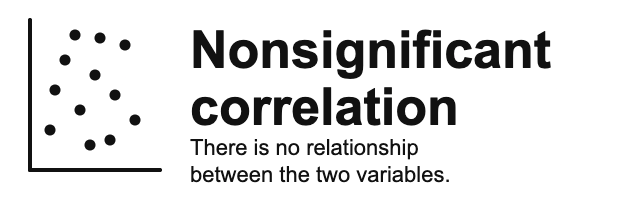
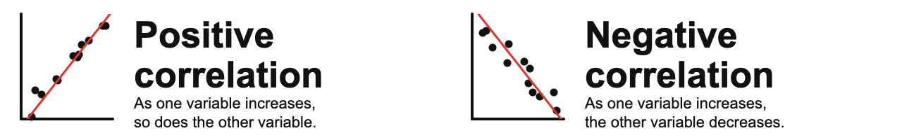
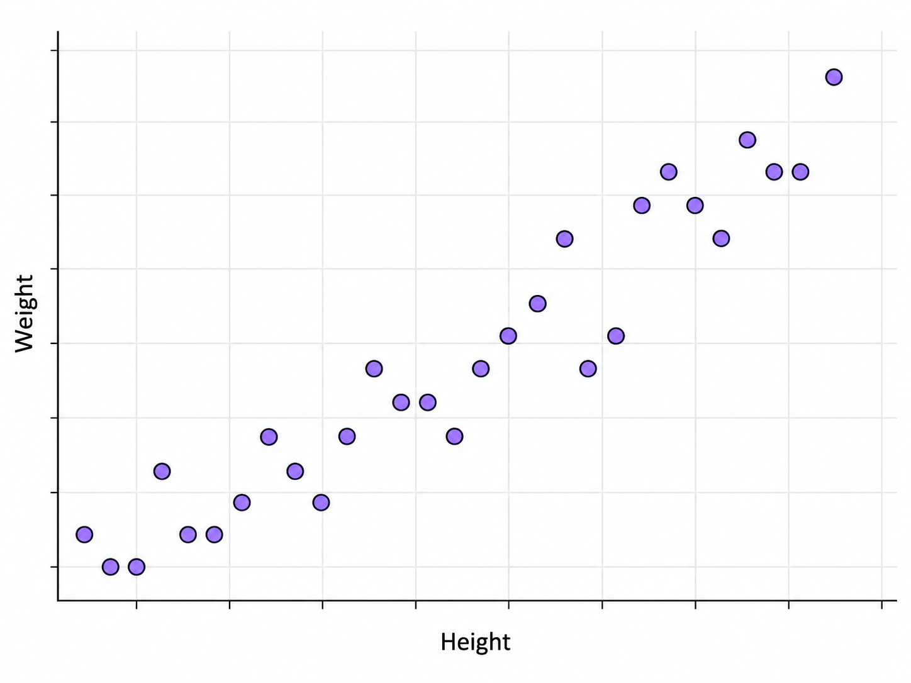
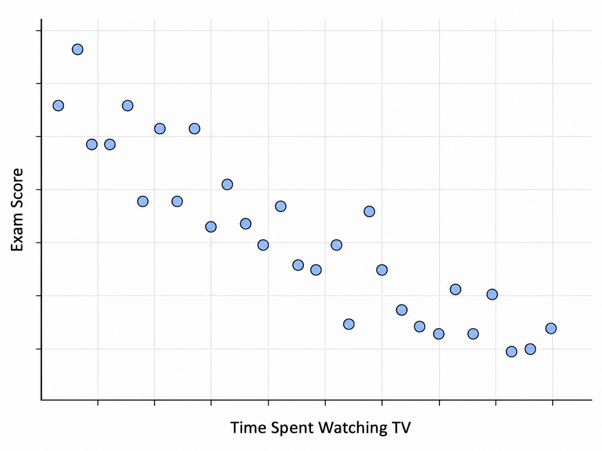
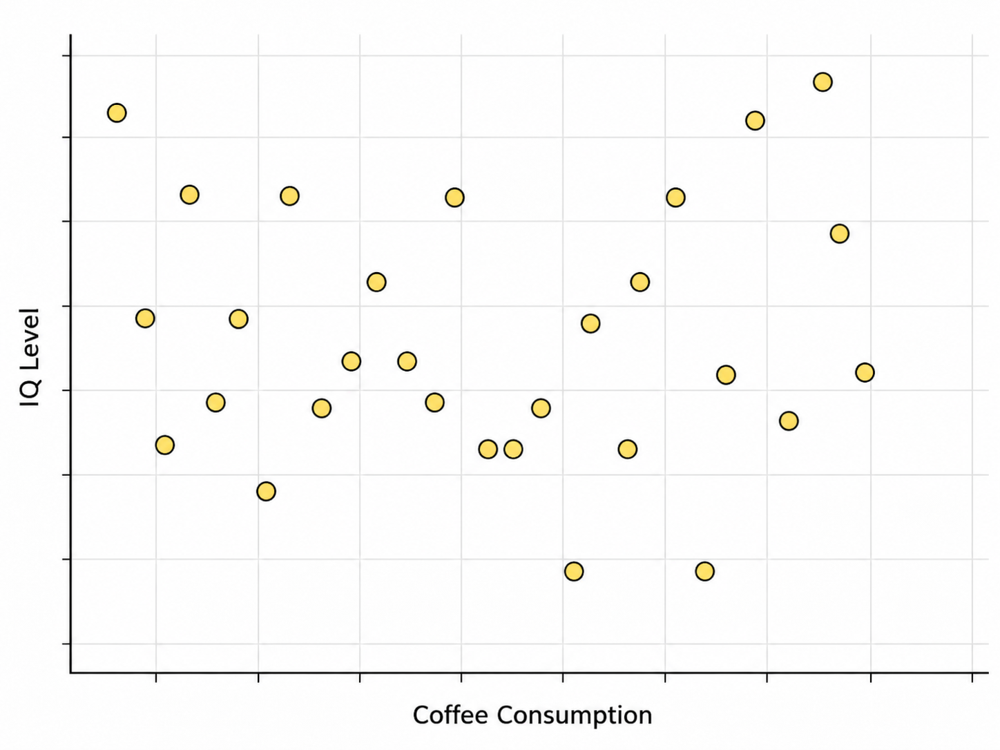
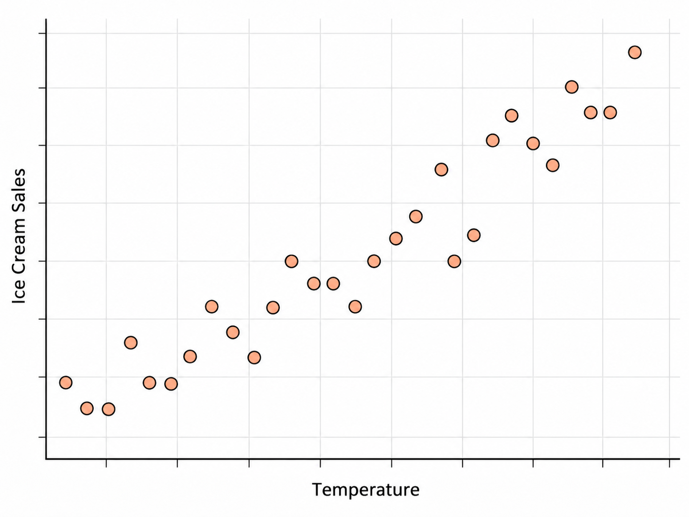
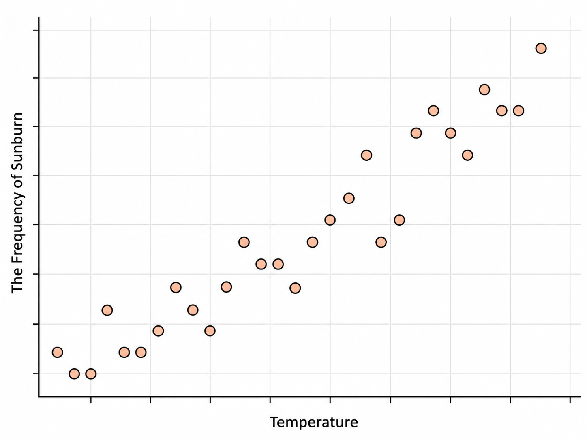
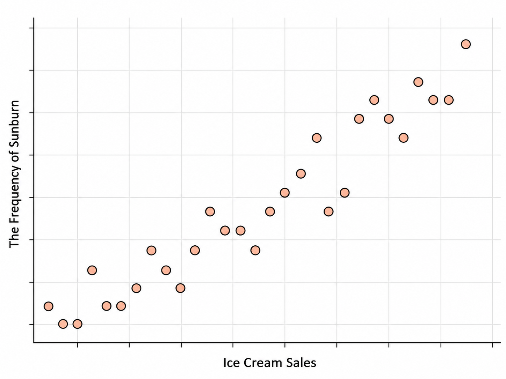
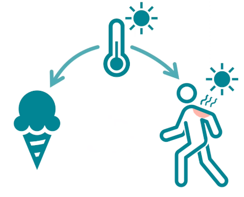

# Module items  { data-readaloud-exclude }
## R Script file code { data-readaloud-exclude }
- :lucide-clipboard-copy: [[Copy the code]] below ➜ Paste into [[RStudio console]] ➜ Hit ++enter++
    - ```r
    source(url("https://raw.githubusercontent.com/ttezcann/ssric-reg/refs/heads/main/docs/assets/attachments/data/0-packages-data.R")); 
    (function(f="10-correlation.R"){if(!file.exists(f)){download.file("https://raw.githubusercontent.com/ttezcann/ssric-reg/refs/heads/main/docs/assets/attachments/modules/10.-correlation-analysis/10-correlation.R",f,mode="wb");file.edit(f)}else{download.file("https://raw.githubusercontent.com/ttezcann/ssric-reg/refs/heads/main/docs/assets/attachments/modules/10.-correlation-analysis/10-correlation.R",gsub(".R","-original.R",f),mode="wb");file.edit(gsub(".R","-original.R",f))}})()
    ```
        - When this R script file opens in a new tab, [[Save R script file|save your previous R script file(s)]], and 
            - Close the previous tabs (R Script files), which you can find later in the [[Files tab]].

## Lab assignment { data-readaloud-exclude }
[Correlation :lucide-download:](https://github.com/ttezcann/ssric-reg/raw/refs/heads/main/docs/assets/attachments/modules/10.-correlation-analysis/10-correlation.docx){ .md-button .md-button--primary }

### Sample lab assignment  { data-readaloud-exclude }
[Sample: Correlation :lucide-download:](https://github.com/ttezcann/ssric-reg/raw/refs/heads/main/docs/assets/attachments/modules/10.-correlation-analysis/10.1-sample-correlation.docx){ .md-button .md-button--primary }

## Suggested reading  { data-readaloud-exclude }
<div class="grid cards" markdown>
- :lucide-book-open:  
Weinstein, Jay A. 2010. “Correlation Description and Induction in Comparative Sociology.” Pp. 297–324 in Applying social statistics: An introduction to quantitative reasoning in sociology. Lanham: Rowman & Littlefield.
</div>

<!-- slide-break -->
## Learning outcomes 
1. Learn the basic terms and concepts related to the correlation analysis
2. Define the purpose of bivariate and multivariate correlation analysis
3. Learn how to generate:
    1. Bivariate correlation analysis (two variables):
        1. Correlation table
        2. Scatterplot graph
    2. Multivariate correlation analysis (more than two variables)
        1. Correlation table matrix
        2. Scatterplot graph matrix
4. Learn how to use the p-value to determine whether a correlation is statistically significant
5. Learn how to use the r-value to describe the direction and strength of a relationship between two continuous variables
<!-- slide-break -->
# [[Correlation analysis]] specifics
- Correlation analysis:
    - Examines how two continuous variables are related, especially whether they tend to increase or decrease together.
    - **Correlation is not causation**: A correlation does not show that one variable causes changes in another.
    - Correlation gives us two values:
        - **[[p-value]]**, which helps us decide whether a correlation is **statistically significant**, and
        - **[[r-value]]**, which tells us the **direction** and **strength** of the correlation.
            - The r-value (correlation coefficient) ranges from **-1** to **+1**.
<!-- slide-break -->
## [[Significance of correlation]] (with [[p-value]])
- We begin with the **[[null hypothesis]]**: The two variables have **no linear correlation in the population**.
    - We use the **[[p-value]]** to assess the evidence against this assumption.
        1. **[[Nonsignificant correlation]] (p > 0.05)**: We do not have enough evidence to conclude that the variables are correlated in the population.
            1. {width="600"}
        2. **[[Significant correlation]] (p < 0.05)**: We have evidence against our assumption that there is no linear correlation in the population.
            - We then use the **[[r-value]]** to describe the direction and strength of the correlation.
<!-- slide-break -->
## [[Direction of correlation]] (with [[r-value]])
- We use the **r-value** to determine the direction of a correlation.
    - When the r-value is **positive** (for example, `r = 0.250`), we have a:
        - **[[Positive correlation]]**: As one variable increases, the other variable **tends to increase** as well.
    - When the r-value is **negative** (for example, `r = -0.250`), we have a:
        - **[[Negative correlation]]**: As one variable increases, the other variable **tends to decrease**.
            - {width="900"}
<!-- slide-break -->
## [[Strength of correlation]] (with [[r-value]])
- We use the absolute value of the **[[r-value]]** written as **|r|**, to describe the strength of a correlation. The vertical bars mean that we ignore whether the r-value is positive or negative. In this course, we use these guidelines:
    - **|r| < 0.3** ➜ [[weak correlation]]
        - r = 0.251 and r = **-**0.251 are both weak correlations.
    - **0.3 ≤ |r| < 0.5** ➜ [[moderate correlation]]
        - r = 0.426 and r = **-**0.426 are both moderate correlations.
    - **|r| ≥ 0.5** ➜ [[strong correlation]]
        - r = 0.785 and r = **-**0.785 are both strong correlations.
            - {width="900"}
        - !!! info "Use the size of the r-value to compare strength, regardless of whether it is positive or negative."
            - **r = -0.673** is stronger than **r = 0.567** because 0.673 is greater than 0.567.
            - **r = -0.432** is stronger than **r = 0.322** because 0.432 is greater than 0.322.
            - **r = 0.567** is stronger than **r = -0.322** because 0.567 is greater than 0.322.
                - The **minus sign** tells us the **direction**, not how strong the correlation is.
<!-- slide-break -->
# Guessing correlation type exercise
- !!! abstract "1. Height and weight"
    - Is there a correlation between height and weight? If yes, positive or negative?
        - ??? tip "Show the answer"
            - The correlation between the height of an individual and their weight tends to be positive. 
            - In other words, individuals who are taller also tend to weigh more.
                - {width="500"}
<!-- slide-break -->
- !!! abstract "2. Time spent watching TV and exam scores"
    - Is there a correlation between time spent watching TV and exam scores? If yes, positive or negative?
        - ??? tip "Show the answer"
            - The more time a student spends watching TV, the lower their exam scores tend to be.
            - In this example, time spent watching TV and exam scores have a negative correlation. Students who watch more TV tend to have lower exam scores.
                - {width="500"}
<!-- slide-break -->
- !!! abstract "3. Coffee consumption and intelligence"
    - Is there a correlation between coffee consumption and intelligence? If yes, positive or negative?
        - ??? tip "Show the answer"
            - In this example, the scatterplot does not show a clear correlation between coffee consumption and IQ scores.
            - This does not prove that the two variables are unrelated in the population.
                - {width="500"}
<!-- slide-break -->
- !!! abstract "4. Temperature and ice cream sales"
    - Is there a correlation between temperature and ice cream sales? If yes, positive or negative?
        - ??? tip "Show the answer"
            - The correlation between the temperature and total ice cream sales is positive. 
            - In other words, on hotter days, total ice cream sales tend to be higher.
                - {width="500"}
<!-- slide-break -->
- !!! abstract "5. temperature and frequency of sunburn"
    - Is there a correlation between temperature and frequency of sunburn? If yes, positive or negative?
        - ??? tip "Show the answer"
            - The correlation between the temperature and the frequency of sunburn is positive. 
            - In other words, on hotter days, sunburns tend to be more common.
                - {width="500"}
<!-- slide-break -->
- !!! abstract "6. frequency of sunburn and ice cream sales"
    - Is there a correlation between the frequency of sunburn and ice cream sales? If yes, positive or negative?
        - ??? tip "Show the answer"
            - The correlation between the frequency of sunburn and total ice cream sales is positive. 
            - HOWEVER, ice cream consumption does not cause sunburns or getting a sunburn doesn’t make someone eat more ice cream.
            - Both of these variables, ice cream consumption and sunburn frequency, are higher when it’s hotter outside.
                - {width="500"}
<!-- slide-break -->
# [[Confounding variable]]
- A **confounding variable** is a third variable that helps explain the relationship between the two variables we are studying. Here, **temperature** affects both **frequency of sunburn** and **ice cream sales**.
    - Sunburns and ice cream sales may increase together because both are related to **temperature**, not because one causes the other.
        - {width="400"}
    - **Other confounding variable examples**:
        - Number of schools in a city and number of crimes in a city
            - **Confounding Variable:** City population
        - Shoe size and reading ability in children
            - **Confounding Variable:** Age of the child
        - Outdoor exercise frequency and vitamin D levels
            - **Confounding Variable:** Sunlight exposure
<!-- slide-break -->
# [[Bivariate correlation]]
- Shows the relationship between two continuous variables in a table-graph format:
    - [[Correlation table]] shows this relationship in a table format:
        - Reports the correlation coefficient (r-value) and the p-value used to assess statistical significance.
    - [[Scatterplot graph]] shows this relationship in a graph format:
        - In addition to the r-value and p-value, displays the shape of the relationship.
<!-- slide-break -->
## GSS Example 1: Significant and negative correlation
### The relationship between educ and tvhours
- We may wonder if there's a correlation between the respondents' education in years (`educ`) and television screen time in hours (`tvhours`).
    - Here we do not propose any kind of cause-and-effect.
        - ```mermaid
        flowchart LR
        subgraph F["Continuous variable"]
            A[Respondents' education in years]
        end

        subgraph O["Continuous variable"]
            B[Television screen time in hours]
        end

        A <==>|May have a relationship| B
        ```
<!-- slide-break -->
### Find the variables in Variables in GSS page
1. We want to make sure that `educ` and `tvhours` are continuous variables.
2. [[Search]] these variable names in [Variables in GSS](../resources/variables-in-gss.md){: target="_blank"} page.
    - | Variable name | Variable label | Variable type | Question wording and response categories |
      |---|---|---|---|
      | `educ` | Respondents' education in years | Continuous | What is the highest year of school you completed?<br><br>*(Min: 0, Max: 20)*  |
      | `tvhours` | Television screen time in hours | Continuous  | On the average day, how many hours do you personally watch television? <br><br>*(Min: 0, Max: 24)* |
<!-- slide-break -->
### [[Correlation table]] #code
- **[[Model code]]**
    - ```r linenums="1" hl_lines="1"
    tab_corr (gss[c("variable1_here", "variable2_here")],
    p.numeric = T, triangle="lower")
    ```
- **[[Working code]]**
    - ```r linenums="1" hl_lines="1"
    tab_corr (gss[c("educ", "tvhours")],
    p.numeric = T, triangle="lower")
    ```
        - **Line 1**: We put `educ` here ➜ `variable1_here` and `tvhours` here ➜ `variable2_here`.
            - The order of the variables doesn't matter.
            - [[Find this working code in the R script file]].
                - [[Highlighting and running]] this code will generate the output below (which will appear in the [[viewer tab]] of RStudio).
<!-- slide-break -->
### [[Correlation table]] #output
- |                                   | *Respondents' education in years* | *Television screen time in hours* |
  |:----------------------------------|:---------------------------------:|:---------------------------------:|
  | *Respondents' education in years* |                                   |                                   |
  | *Television screen time in hours* |    r = -0.163<br>==p = <0.001***==|                                   |
<!-- slide-break -->
### [[Scatterplot graph]] #code
- **[[Model code]]**
    - ```r linenums="1" hl_lines="1"
    scatterplot(gss, "variable1_here", "variable2_here")
    ```
- **[[Working code]]**
    - ```r linenums="1"  hl_lines="1"
    scatterplot(gss, "educ", "tvhours")
    ```
        - **Line 1**: We put `educ` here ➜ `variable1_here` and `tvhours` here ➜ `variable2_here`. 
            - The order of the variables doesn't matter. 
            - [[Find this working code in the R script file]].
                - [[Highlighting and running]] this code will generate the output below (which will appear in the [[plots tab]] of RStudio).
<!-- slide-break -->
### [[Scatterplot graph]] #output
- {width="500"}
<!-- slide-break -->
### [[Correlation table]] and [[scatterplot graph]] #interpretation
- !!! note "Significant (p < 0.05) and weak (|r| < 0.3) correlation interpretation sample"
    There is a **statistically significant correlation** between **respondents' education in years** and **television screen time in hours** since the **p-value is less than 0.05**.

    This correlation is **negative and weak** since the **r-value is -0.163**.

    This means that as **respondents' education in years** increases, **television screen time in hours** tends to decrease.
- !!! quote "Significant (p < 0.05) and negative correlation interpretation template"
    - There is a **statistically significant correlation** between **[[variable label]] 1** and **variable label 2** since the **p-value is less than 0.05**.
    - This correlation is **negative and weak** since the **r-value is -0.xxx**.
        - **OR** This correlation is **negative and moderate** since the **r-value is -0.xxx** (if 0.3 ≤ |r| < 0.5).
        - **OR** This correlation is **negative and strong** since the **r-value is -0.xxx** (if |r| ≥ 0.5).
    - This means that as **variable label 1** increases, **variable label 2** tends to decrease.
- !!! success "Interpretation explanation"
    - We first check the **[[p-value]]**.
        - When the p-value is less than 0.05, the correlation is **statistically significant**.
            - This example has a **statistically significant correlation** since **p < 0.05**.
    - We then check the **[[r-value]]**.
        - **Direction:** The minus sign (-) means a **[[negative correlation]]**.
            - Here, **r = -0.163**, so the correlation is negative.
        - **Strength:** We use the size of the r-value without its minus sign. Check the **[[strength of correlation]]** guideline.
            - Here, **|r| = 0.163**, which is less than 0.3, so this is a **[[weak correlation]]**.
<!-- slide-break -->
- !!! tip "Further considerations"
    - **Shape of the [[scatterplot graph]]:** The line stays near 4 hours from 0 to about 11 years of education, then drops steadily after 12 years to about 2.3 hours at 20 years. The decline happens mainly after high school.
    - **Connecting to a sociological concept:** **Cultural capital** suggests that schooling builds tastes for activities other than TV. The significant negative correlation (**r = -0.163, p < 0.001**) fits this idea, but it is weak, and the flat part of the line suggests it applies mainly to education beyond high school.
    - **Responsible reporting:** Describing this weak correlation as strong could lead readers to stereotype less-educated people as lazy, when education explains only a small part of TV time.
    - **Who is missing:** `tvhours` asks only about television, so time spent streaming on phones or laptops is not captured. The result describes TV watching, not all screen time.
<!-- slide-break -->
## GSS Example 2: Significant and positive correlation
### The relationship between masei10 and pasei10
- We may wonder if there's a correlation between the respondents' mothers' socio-economic index score (`masei10`) and fathers' socio-economic index score (`pasei10`).
    - Here we do not propose any kind of cause-and-effect.
        - ```mermaid
        flowchart LR
        subgraph F["Continuous variable"]
            A[Mothers' SES]
        end

        subgraph O["Continuous variable"]
            B[Fathers' SES]
        end

        A <==>|May have a relationship| B
        ```
<!-- slide-break -->
### Find the variables in Variables in GSS page
1. We want to make sure that `masei10` and `pasei10` are continuous variables.
2. [[Search]] the variable names, `masei10` and `pasei10`, in [Variables in GSS](../resources/variables-in-gss.md){: target="_blank"} page.
    - | Variable name | Variable label | Variable type | Question wording and response categories |
      |---|---|---|---|
      | `masei10` | Respondents' mothers' socio-economic index score | Continuous | Respondent's mother's socio-economic index score (calculated)<br><br>*(Min: 9, Max: 92.8)* |
      | `pasei10`  | Respondents' fathers' socio-economic index score | Continuous | Respondent's father's socio-economic index score (calculated)<br><br>*(Min: 9, Max: 93.7)* |
<!-- slide-break -->
### [[Correlation table]] #code
- **[[Model code]]**
    - ```r linenums="1" hl_lines="1"
    tab_corr (gss[c("variable1_here", "variable2_here")],
    p.numeric = T, triangle="lower")
    ```
- **[[Working code]]**
    - ```r linenums="1" hl_lines="1"
    tab_corr (gss[c("masei10", "pasei10")],
    p.numeric = T, triangle="lower")
    ```
        - **Line 1**: We put `masei10` here ➜ `variable1_here` and `pasei10` here ➜ `variable2_here`. 
            - The order of the variables doesn't matter.
            - [[Find this working code in the R script file]].
                - [[Highlighting and running]] this code will generate the output below (which will appear in the [[viewer tab]] of RStudio).
<!-- slide-break -->
### [[Correlation table]] #output
- |                                                    | *Respondents' mothers' socio-economic index score* | *Respondents' fathers' socio-economic index score* |
  |:---------------------------------------------------|:--------------------------------------------------:|:--------------------------------------------------:|
  | *Respondents' mothers' socio-economic index score* |                                                    |                                                    |
  | *Respondents' fathers' socio-economic index score* |           r = 0.364<br>==p < 0.001***==            |                                                    |
<!-- slide-break -->
### [[Scatterplot graph]]  #code
- **[[Model code]]**
    - ```r linenums="1"  hl_lines="1"
    scatterplot(gss, "variable1_here", "variable2_here")
    ```
- **[[Working code]]**
    - ```r linenums="1" hl_lines="1"
    scatterplot(gss, "masei10", "pasei10")
    ```
        - **Line 1**: We put `masei10` here ➜ `variable1_here` and `pasei10` here ➜ `variable2_here`. 
            - The order of the variables doesn't matter. 
            - [[Find this working code in the R script file]].
                - [[Highlighting and running]] this code will generate the output below (which will appear in the [[plots tab]] of RStudio).
<!-- slide-break -->
### [[Scatterplot graph]] #output
- {width="500"}
<!-- slide-break -->
### [[Correlation table]] and [[scatterplot graph]] #interpretation
- !!! note "Significant (p < 0.05) and moderate (0.3 ≤ |r| < 0.5) correlation interpretation sample"
    There is a **statistically significant correlation** between **respondents' mothers' socio-economic index score** and **respondents' fathers' socio-economic index score** since the **p-value is less than 0.05**.

    This correlation is **positive and moderate** since the **r-value is 0.364**.

    This means that respondents with **higher mothers' socio-economic index scores** also tend to have **higher fathers' socio-economic index scores**.
- !!! quote "Significant (p < 0.05) and positive correlation interpretation template"
    - There is a **statistically significant correlation** between **[[variable label]] 1** and **variable label 2** since the **p-value is less than 0.05**.
    - This correlation is **positive and moderate** since the **r-value is 0.xxx**.
        - **OR** This correlation is **positive and weak** since the **r-value is 0.xxx** (if |r| < 0.3).
        - **OR** This correlation is **positive and strong** since the **r-value is 0.xxx** (if |r| ≥ 0.5).
    - This means that as **variable label 1** increases, **variable label 2** tends to increase as well.
- !!! success "Interpretation explanation"
    - We first check the **[[p-value]]**.
        - When the p-value is less than 0.05, the correlation is **statistically significant**.
            - This example has a **statistically significant correlation** since **p < 0.05**.
    - We then check the **[[r-value]]**. 
        - **Direction:** A positive r-value means a **[[positive correlation]]**.
            - Here, **r = 0.364**, so the correlation is positive.
        - **Strength:** We use the size of the r-value without its minus sign. Check the **[[strength of correlation]]** guideline.
            - Here, **|r| = 0.364**, which is between 0.3 and 0.5, so this is a **[[moderate correlation]]**.
- !!! tip "Further considerations"
    - **Shape of the [[scatterplot graph]]:** The line rises steeply from about 30 to about 49 as mothers' scores go from about 10 to 45, levels off near 50 between 45 and 60, then rises again to about 66. The relationship is positive everywhere, but not equally strong.
    - **Connecting to a sociological concept:** **Assortative mating (homogamy)** suggests that people choose partners with similar social status. The significant positive correlation (**r = 0.364, p < 0.001**) fits this idea, but it is moderate, so parents also matched on things besides job status, such as education and religion.
    - **Responsible reporting:** Describing this moderate correlation as strong could lead readers to believe that people almost always marry within their own class.
    - **Who is missing:** Both scores come from parents' paid jobs, so families with a stay-at-home parent, or respondents who did not know a parent, drop out. The result mostly describes two-parent families in which both parents worked for pay.
<!-- slide-break -->
## Example 3: Nonsignificant correlation
### The relationship between hrs1 and sibs
- We may wonder if there's a correlation between the number of hours respondents worked last week (`hrs1`) and the number of brothers and sisters respondents have (`sibs`).
    - Here we do not propose any kind of cause-and-effect.
        - ```mermaid
        flowchart LR
        subgraph F["Continuous variable"]
            A[Hours worked last week]
        end

        subgraph O["Continuous variable"]
            B[# of brothers and sisters]
        end

        A <==>|May have a relationship| B
        ```
<!-- slide-break -->
### Find the variables in Variables in GSS page
1. We want to make sure that `hrs1` and `sibs` are continuous variables.
2. [[Search]] the variable names, `hrs1` and `sibs`, in [Variables in GSS](../resources/variables-in-gss.md){: target="_blank"} page.
    - | Variable name | Variable label | Variable type | Question wording and response categories |
      |---|---|---|---|
      | `hrs1` | Number of hours respondents worked last week | Continuous | How many hours did you work last week, at all jobs? <br><br>*(Min: 0, Max: 89)* |
      | `sibs` | Number of brothers and sisters respondents have | Continuous | How many brothers and sisters do you have? <br><br>*(Min: 0, Max: 6)*  |
<!-- slide-break -->
### [[Correlation table]] #code
- **[[Model code]]**
    - ```r linenums="1"  hl_lines="1"
    tab_corr (gss[c("variable1_here", "variable2_here")],
    p.numeric = T, triangle="lower")
    ```
- **[[Working code]]**
    - ```r linenums="1"  hl_lines="1"
    tab_corr (gss[c("hrs1", "sibs")], 
    p.numeric = T, triangle="lower")
    ```
        - **Line 1**: We put `hrs1` here ➜ `variable1_here` and `sibs` here ➜ `variable2_here`. 
            - The order of the variables doesn't matter. 
            - [[Find this working code in the R script file]].
                - [[Highlighting and running]] this code will generate the output below (which will appear in the [[viewer tab]] of RStudio).
<!-- slide-break -->
### [[Correlation table]] #output
- |                                                   | *Number of hours respondents worked last week* | *Number of brothers and sisters respondents have* |
  |:--------------------------------------------------|:----------------------------------------------:|:-------------------------------------------------:|
  | *Number of hours respondents worked last week*    |                                                |                                                   |
  | *Number of brothers and sisters respondents have* |            r = -0.039<br>==p = 0.068==         |                                                   |
<!-- slide-break -->
### [[Scatterplot graph]]  #code
- **[[Model code]]**
    - ```r linenums="1"  hl_lines="1"
    scatterplot(gss, "variable1_here", "variable2_here")
    ```
- **[[Working code]]**
    - ```r linenums="1" hl_lines="1"
    scatterplot(gss, "hrs1", "sibs")
    ```
        - **Line 1**: We put `hrs1` here ➜ `variable1_here` and `sibs` here ➜ `variable2_here`. 
            - The order of the variables doesn't matter. 
            - [[Find this working code in the R script file]].
                - [[Highlighting and running]] this code will generate the output below (which will appear in the [[viewer tab]] of RStudio).
<!-- slide-break -->
### [[Scatterplot graph]] #output
- {width="500"}
<!-- slide-break -->
### [[Correlation table]] and [[scatterplot graph]] #interpretation
- !!! note "Nonsignificant (p > 0.05) correlation interpretation sample"
    There is **no statistically significant correlation** between **the number of hours respondents worked last week** and **the number of brothers and sisters respondents have** since the **p-value is greater than 0.05**.

    We conclude that **the number of hours respondents worked last week** and **the number of brothers and sisters respondents have** are **not related in a statistically significant way**.
- !!! quote "Nonsignificant (p > 0.05) correlation interpretation template"
    There is **no statistically significant correlation** between **[[variable label]] 1** and **variable label 2** since the **p-value is greater than 0.05**.

    We conclude that **variable label 1** and **variable label 2** are **not related in a statistically significant way**.
- !!! success "Interpretation explanation"
    - We first check the **[[p-value]]**.
        - When the p-value is greater than 0.05, we do not have enough evidence to conclude that the variables are correlated in the population.
            - This example has a **[[nonsignificant correlation]]** since **p = 0.068**.
- !!! tip "Further considerations"
    - **Shape of the [[scatterplot graph]]:** The line moves up and down between about 2.5 and 3.1 siblings, with no consistent direction, and the gray band is wide at both ends. These small ups and downs are not a real pattern.
    - **Connecting to a sociological concept:** **Resource dilution** suggests that children from larger families get fewer resources, which could shape their working lives. The nonsignificant correlation (**r = -0.039, p = 0.068**) gives no evidence for this. The concept may apply to education or status instead of to how many hours people work.
    - **Responsible reporting:** A nonsignificant result is still worth reporting. Leaving it out would make the concept look as if it explains more than it does.
    - **Who is missing:** `hrs1` counts only people who worked last week, so retirees, unemployed people, and full-time caregivers are left out. The result describes working adults only.
<!-- slide-break -->
# [[Multivariate correlation]]
- Shows the relationships among multiple (more than two) continuous variables in a table-graph format.
    - A correlation matrix examines each **pair of variables** separately.
    - [[Correlation table matrix]] shows these relationships in a table format:
        - Reports each pair's correlation coefficient (r-value) and p-value.
    - [[Scatterplot graph matrix]] shows these relationships in a graph format:
        - In addition to the r-value and p-value, displays the shape of the relationship.
<!-- slide-break -->
## GSS Example 1: Correlation table matrix
### Find the variables in Variables in GSS page
- We'll use all the variables we have used so far in the previous sections.
    - | Variable name | Variable label | Variable type | Question wording and response categories |
      |---|---|---|---|
      | `educ` | Respondents' education in years | Continuous | What is the highest year of school you completed?<br><br>*(Min: 0; Max: 20)*  |
      | `tvhours` | Television screen time in hours | Continuous  | On the average day, how many hours do you personally watch television?<br><br>*(Min: 0; Max: 24)*  |
      | `masei10` | Respondents' mothers' socio-economic index score | Continuous | Respondent's mother's socio-economic index score (calculated)<br><br>*(Min: 0; Max: 100)* |
      | `pasei10` | Respondents' fathers' socio-economic index score | Continuous | Respondent's father's socio-economic index score (calculated)<br><br>*(Min: 0; Max: 100)* |
      | `hrs1` | Number of hours respondents worked last week | Continuous | How many hours did you work last week, at all jobs?<br><br>*(Min: 0; Max: 89)*  |
      | `sibs` | Number of brothers and sisters respondents have | Continuous | How many brothers and sisters do you have?<br><br>*(Min: 0; Max: 6)*  |
<!-- slide-break -->
### [[Correlation table matrix]] #code
- **[[Model code]]**
    - ```r linenums="1"  hl_lines="1"
    tab_corr (gss[, c("variable1_here", "variable2_here", "variable3_here", "variable4_here", "variable5_here", "variable6_here")],  
    p.numeric = T, triangle="lower", na.deletion = "pairwise")
    ```
- **[[Working code]]**
    - ```r linenums="1"  hl_lines="1"
    tab_corr (gss[, c("educ", "tvhours", "masei10", "pasei10", "hrs1", "sibs")], 
    p.numeric = T, triangle="lower", na.deletion = "pairwise")
    ```
        - **Line 1**: We put the previous variables here ➜ `variable1_here` and `variable2_here` and so on. 
            - [[Find this working code in the R script file]].
                - [[Highlighting and running]] this code will generate the output below (which will appear in the [[viewer tab]] of RStudio).
<!-- slide-break -->
### [[Correlation table matrix]] #output
- |  | Respondents' education | TV screen time | Mothers' SES | Fathers' SES | Hours worked last week | Number of siblings |
  |---|:---:|:---:|:---:|:---:|:---:|:---:|
  | Respondents' education |  |  |  |  |  |  |
  | TV screen time | r = -0.163<br>*p* < 0.001*** |  |  |  |  |  |
  | Mothers' SES  | r = 0.287<br>*p* < 0.001*** | r = -0.125<br>*p* < 0.001*** |  |  |  |  |
  | Fathers' SES  | r = 0.353<br>*p* < 0.001*** | r = -0.123<br>*p* < 0.001*** | r = 0.364<br>*p* < 0.001*** |  |  |  |
  | Hours worked last week | r = 0.026<br>*p* = 0.226 | r = -0.029<br>*p* = 0.265 | r = 0.034<br>*p* = 0.170 | r = -0.024<br>*p* = 0.338 |  |  |
  | Number of siblings  | r = -0.208<br>*p* < 0.001*** | r = 0.104<br>*p* < 0.001*** | r = -0.221<br>*p* < 0.001*** | r = -0.187<br>*p* < 0.001*** | r = -0.039<br>*p* = 0.068 |  |
<!-- slide-break -->
### [[Scatterplot graph matrix]] #code
- **[[Model code]]**
    - ```r linenums="1" hl_lines="1"
    scatterplot_matrix <- gss[, c("variable1_here", "variable2_here", "variable3_here", "variable4_here", "variable5_here", "variable6_here")]
    pairs_panels_pval(scatterplot_matrix, color = "#15616d")
    ```
- **[[Working code]]**
    - ```r linenums="1" hl_lines="1"
    scatterplot_matrix <- gss[, c("educ", "tvhours", "masei10", "pasei10", "hrs1", "sibs")]
    pairs_panels_pval(scatterplot_matrix, color = "#15616d")
    ```
        - **Line 1**:  We put the previous variables here ➜ `variable1_here` and `variable2_here` and so on. 
            - [[Find this working code in the R script file]].
                - [[Highlighting and running]] this code will generate the output below (which will appear in the [[plots tab]] of RStudio).
<!-- slide-break -->
### [[Scatterplot graph matrix]] #output
- ![A scatterplot matrix showing correlations among six variables: educ, tvhours, masei10, pasei10, hrs1, and sibs. The diagonal displays histograms for each variable. The upper-right triangle shows r-values and p-values for each variable pair. The lower-left triangle shows scatterplots. Annotations highlight how to locate two variables of interest (tvhours and hrs1): find their histograms on the diagonal (1), their correlation in the upper-right intersection (2, r=-0.029, p=0.265), and their scatterplot in the lower-left intersection (3).](../assets/attachments/modules/10.-correlation-analysis/scatterplot-matrix.png)
<!-- slide-break -->
    1. **Start with the diagonal**: 
        1. Find your two variables of interest: here, for example, `tvhours` and `hrs1`. 
        1. The diagonal cells (in red) show each variable's distribution as a histogram.
    1. **Look upper-right**: 
        1. The upper-right cell (in purple) at the intersection of your two variables reports the correlation coefficient (r-value) and statistical significance (p-value). Here, r=-0.029, p=0.265.
    1. **Look lower-left**: 
        1. The lower-left cell (in blue) at the same intersection shows the scatterplot.
<!-- slide-break -->
### [[Correlation table matrix]] and [[scatterplot graph matrix]] #interpretation
- !!! note "Nonsignificant (p > 0.05) correlation interpretation sample"
    There is **no statistically significant correlation** between **television screen time in hours** and **the number of hours respondents worked last week** since the **p-value is greater than 0.05**.

    We conclude that **television screen time in hours** and **the number of hours respondents worked last week** are **not related in a statistically significant way**.
- !!! quote "Nonsignificant (p > 0.05) correlation interpretation template"
    There is **no statistically significant correlation** between **[[variable label]] 1** and **variable label 2** since the **p-value is greater than 0.05**.

    We conclude that **variable label 1** and **variable label 2** are **not related in a statistically significant way**.
- !!! success "Interpretation explanation"
    - We first check the **[[p-value]]** for the two variables we are comparing.
        - When the p-value is greater than 0.05, we do not have enough evidence to conclude that the variables are correlated in the population.
            - This example has a **[[nonsignificant correlation]]** since **p = 0.265**.
- !!! tip "Further considerations"
    - **Shape of the [[scatterplot graph]]:** In the lower-left cell, the line stays flat near 40 hours of work at every level of TV time. The `hrs1` histogram explains why: most respondents worked about 40 hours last week.
    - **Connecting to a sociological concept:** **Time bind** suggests that long work hours leave less free time for TV. The nonsignificant correlation (**r = -0.029, p = 0.265**) gives no evidence for this. Because most workers work about the same hours, there is little difference in work hours to connect to TV time.
    - **Responsible reporting:** A nonsignificant result does not prove that there is "no relationship" at all. It means we do not have enough evidence of one in this data.
    - **Who is missing:** `hrs1` leaves out everyone who did not work last week, including retirees, who tend to watch the most TV. The result describes TV time among working adults, not all adults.
<!-- slide-end -->