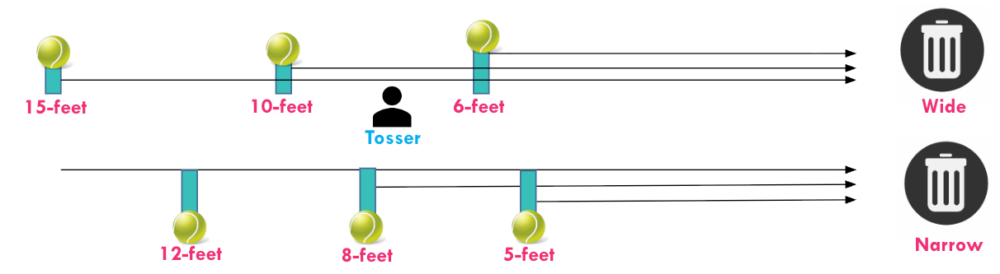

# Module items  { data-readaloud-exclude }
## R Script file code { data-readaloud-exclude }
- :lucide-clipboard-copy: [[Copy the code]] below ➜ Paste into [[RStudio console]] ➜ Hit ++enter++  
    - ```r
    source(url("https://raw.githubusercontent.com/ttezcann/ssric-reg/refs/heads/main/docs/assets/attachments/data/0-packages-data-trashball.R"));
    (function(f="14-modeling-exercises.R"){if(!file.exists(f)){download.file("https://raw.githubusercontent.com/ttezcann/ssric-reg/refs/heads/main/docs/assets/attachments/modules/14.-modeling-exercises/14-modeling-exercises.R",f,mode="wb");file.edit(f)}else{download.file("https://raw.githubusercontent.com/ttezcann/ssric-reg/refs/heads/main/docs/assets/attachments/modules/14.-modeling-exercises/14-modeling-exercises.R",gsub(".R","-original.R",f),mode="wb");file.edit(gsub(".R","-original.R",f))}})()
    ```
        - When this R script file opens in a new tab, [[Save R script file|save your previous R script file(s)]], and 
            - Close the previous tabs (R Script files), which you can find later in the [[Files tab]].

## Lab assignment  { data-readaloud-exclude }
[Modeling exercises :lucide-download:](https://github.com/ttezcann/ssric-reg/raw/refs/heads/main/docs/assets/attachments/modules/14.-modeling-exercises/14-modeling-exercises.docx){ .md-button .md-button--primary }

### Sample lab assignment  { data-readaloud-exclude }
[Sample: Modeling exercises :lucide-download:](https://github.com/ttezcann/ssric-reg/raw/refs/heads/main/docs/assets/attachments/modules/14.-modeling-exercises/14.1-sample-modeling-exercises.docx){ .md-button .md-button--primary }

## Suggested reading  { data-readaloud-exclude }
<div class="grid cards" markdown>
- :lucide-book-open:  
Sperandei, Sandro. 2014. “Understanding Logistic Regression Analysis.” Biochemia Medica 24(1):12–18. doi:10.11613/BM.2014.003
</div>

<!-- slide-break -->
## Learning outcomes
1. Apply logistic regression to a different dataset
<!-- slide-break -->
# The content of the module
- We will use the dataset created during in-person classes in previous semesters.
- 189 students tossed a ball into a trash can from various distances.
- Those 189 students also filled out a survey with information (both relevant and irrelevant) to predict targeting trash can.
<!-- slide-break -->
# Trashball: Logistic regression classroom activity
- 
    - The activity involved students attempting to toss a ball into a trash can from various distances.
    - Students targeted the wide trash can from 6, 10, 15-feet away and the narrow trash can from 5, 8, 12-feet away.
<!-- slide-break -->
# Recorded data and survey
- | Variable name | Variable label | Variable type | Question wording and response categories | Comparison category |
  |---|---|---|---|---|
  | `success` | Hitting the target | Binary-Dummy | Recorded data:<br><br>*(1: Success; 0: No success)*  |  |
  | `distance` | Distance from the trash can| Continuous | Recorded data:<br><br>*(Min: 5, Max: 15 feet)*  |  |
  | `narrow` | Tossing a ball to a narrow trash can| Binary-Dummy  | Recorded data:<br><br>*(1: Tossing a ball to a narrow trash can; 0: Tossing a ball to a wide trash can )*  | Tossing a ball to a wide trash can |
  | `sleep` | Having at least seven hours sleep | Binary-Dummy  | Did you sleep at least 7 hours last night? <br><br>*(1: Yes; 0: No)*  |Having less than seven hours sleep|
  | `hungry` | Hunger level |  Ordinal ✅  | How hungry are you right now? <br><br>*(1: Not hungry at all;  2: Slightly hungry, 3: Moderately hungry, 4: Very hungry; 5: Extremely hungry)*  ||
  | `physicallyactive` | The level of physical activity|  Ordinal ✅  | How physically active are you on a regular basis? <br><br>*(1: Not at all;  2: Slightly active;  3: Moderately active;  4: Very active; 5: Extremely active)*  ||
  | `regularsports` | Playing sports regularly |  Binary-Dummy   | Do you play any sports regularly? <br><br>*(1: Yes; 0: No)*  |Not playing sports regularly|
  | `physicallycoordinated` | The level of physical coordination|  Ordinal ✅  | Do you consider yourself physically coordinated?<br><br>*(1: Not at all; 2: Slightly; 3: Moderately; 4: Very; 5: Extremely)*  ||
  | `competitive` | The level of competitiveness|  Ordinal ✅  | How competitive do you consider yourself to be?<br><br>*(1: Not at all; 2: Slightly; 3: Moderately; 4: Very; 5: Extremely)*  ||
  | `outgoing` | The level of outgoingness |  Ordinal ✅  | Would you describe yourself as outgoing?<br><br>*(1: Not at all, 2: Slightly; 3: Moderately; 4: Very; 5: Extremely)*  ||
  | `nervous` | The level of nervousness  |  Ordinal ✅  | How nervous do you generally feel in new situations? <br><br>*(1: Not at all; 2: Slightly; 3: Moderately; 4: Very; 5: Extremely)* ||
  | `confidence` | The level of confidence|  Ordinal ✅  | How confident do you feel in general, day-to-day? <br><br>*(1: Not confident at all; 2: Slightly confident; 3: Moderately confident; 4: Very confident; 5: Extremely confident)*  |
    - !!! success "Binary variables are already dummy"
        Binary variables, `success`, `distance`, `narrow`, `sleep`, and `regularsports`, are already recorded as dummy variable, **1-0**.
<!-- slide-break -->
- In this analysis, we propose a cause-and-effect relationship in which these factor variables may affect (increase or decrease) the odds of hitting the target.
    - ```mermaid
    flowchart LR
        subgraph C0[Continuous factor variable]
            direction BT
            C01[Distance from the trash can]
            C02[Physical coordination]
        end

        subgraph D0[Dummy factor variables]
            subgraph I0[Narrow]
                direction TB
                I1[Narrow trash can]
                I2[Wide trash can]
            end

            subgraph M0[Playing sports regularly]
                direction TB
                M1[1: Yes]
                M2[0: No]
            end
        end

        subgraph O0[Dummy outcome variable]
            E[Success<br><br>1: Hitting <br><br> 0: Not hitting]
        end

        C01 -.->|Association?| E
        C02 -.->|Association?| E
        I0 -.->|Association?| E
        M0 -.->|Association?| E
    ```
<!-- slide-break -->
## [[Logistic regression]] #code
- **[[Model code]]**
    - ```r linenums="1"  hl_lines="1 2"
    model1 <- glm(dummy_outcome_here ~ factor1_here + factor2_here + factor3_here, data = trashball, family = binomial(link="logit"))
    tab_model(model1, show.std = T, show.ci = F, collapse.se = T)
    ```
- **[[Working code]]**
    - ```r linenums="1"  hl_lines="1 2"
    model1 <- glm(success ~ distance + narrow + physicallycoordinated + regularsports, data = trashball, family = binomial(link="logit"))
    tab_model(model1, show.std = T, show.ci = F, collapse.se = T)
    ```
        - **Line 1:**  We  put `success` here ➜ `outcome_here`; `distance` here ➜ `factor1_here`; `narrow` here ➜ `factor2_here`; `physicallycoordinated` here ➜ `factor3_here`; `regularsports` here ➜ `factor4_here`.
            - Outcome variable variable first; then, factor variables separated by plus (+).
        - **Line 2:** Check the first argument: `model1`. If this is model1, then we should use model1 here
            - This needs to be `model1`, otherwise this code won't work.
            - Note that the data argument is different since we use a different dataset: `data = trashball`.
                - [[Find this working code in the R script file]].
                    - [[Highlighting and running]] this code will generate the output below (which will appear in the [[viewer tab]] of RStudio).
<!-- slide-break -->
## [[Logistic regression]] #output
- **Hitting the target**
    - | Factors                              |    Odds Ratios     |    std. OR     |      p       |
      |--------------------------------------|:------------------:|:--------------:|:------------:|
      | (Intercept)                          | 278.29<br>(336.53) | 0.64<br>(0.18) | **<0.001***** |
      | Distance from the trash can          |   0.37<br>(0.06)   | 0.03<br>(0.02) | **<0.001***** |
      | Tossing a ball to a narrow trash can |   0.10<br>(0.06)   | 0.32<br>(0.09) | **<0.001***** |
      | The level of physical coordination   |   1.48<br>(0.41)   | 1.57<br>(0.50) |    0.156     |
      | Playing sports regularly             |  13.70<br>(11.49)  | 3.27<br>(1.24) | **0.002****  |
      | Observations                         |        189         |                |              |
      | R² Tjur                              |       0.645        |                |              |
<!-- slide-break -->
## [[Logistic regression]] with dummy variables #interpretation
- !!! note "Logistic regression with dummy variables interpretation sample"
    - **First section: The significance levels**
        - Distance from the trash can, tossing a ball to a narrow trash can, and playing sports regularly have statistically significant associations with hitting the target since their p-values are less than 0.05.
        - The level of physical coordination is not a statistically significant factor of hitting the target since the p-value is greater than 0.05.
    - **Second section: The explanation of odds ratios**
        - One additional foot of distance from the trash can is associated with **2.70 times lower odds** of hitting the target.
        - Tossing a ball to a narrow trash can is associated with **10.00 times lower odds** of hitting the target compared with tossing a ball to a wide trash can.
        - Playing sports regularly is associated with **13.70 times higher odds** of hitting the target compared with not playing sports regularly.
    - **Third section: The explanation of standardized odds ratios**
        - The largest standardized association with the odds of hitting the target is for distance from the trash can (std. OR=33.33), followed by playing sports regularly (std. OR=3.27), and tossing a ball to a narrow trash can (std. OR=3.13).
    - **Fourth section: The explanation of Tjur R-squared**
        - The Tjur R-squared value indicates that the model, which includes distance from the trash can, tossing a ball to a narrow trash can, the level of physical coordination, and playing sports regularly, distinguishes between the two groups with a 64.5 percentage-point difference in their average predicted probabilities.
<!-- slide-break -->
- !!! quote "Logistic regression with dummy variables interpretation template"
    - **First section: The significance levels**
        - **[[Variable label]]** of significant **[[factor variable]] 1**, **variable label** of significant **factor variable 2**, **variable label** of significant **factor variable 3**... have statistically significant associations with **variable label** of **[[outcome variable]]** since their p-values are less than 0.05.
        - **[If any]:** **Variable label** of nonsignificant **factor variable 4** is not a statistically significant factor of **variable label** of **outcome variable** since the p-value is greater than 0.05.
    - **Second section: The explanation of odds ratios**
        - One additional **[year/point/unit/score of factor variable 1]** of **variable label** of significant **factor variable 1** is associated with **[odds ratio] times higher/lower odds** of **variable label** of **outcome variable**.
        - **Variable label** of **included dummy variable 1** is associated with **[odds ratio] times higher/lower odds** of **variable label** of **outcome variable** compared with **variable label of omitted - comparison dummy variable 1**.
        - **Variable label** of **included dummy variable 2** is associated with **[odds ratio] times higher/lower odds** of **variable label** of **outcome variable** compared with **variable label of omitted - comparison dummy variable 2**.
    - **Third section: The explanation of standardized odds ratios**
        - The largest standardized association with the odds of **variable label** of **outcome variable** is for **variable label** of the strongest **factor variable** **(std. OR=[value])**, followed by **variable label** of the second strongest **factor variable** **(std. OR=[value])**...
            - When a standardized odds ratio is less than 1, divide **1 by the standardized odds ratio** before comparing the sizes of associations.
    - **Fourth section: The explanation of Tjur R-squared**
        - The **[[Tjur R-squared]]** value indicates that the model, which includes **variable label** of **factor variable 1**, **variable label** of **factor variable 2**, **variable label** of **factor variable 3**..., distinguishes between the two groups with a **[Tjur R-squared × 100] percentage-point difference** in their average predicted probabilities.
<!-- slide-break -->
- !!! success "Interpretation explanation"
    - **First section: The significance levels**
        - We identify the **variable labels** of factor variables that have statistically significant associations with the odds of the **outcome variable**.
            - When the p-value is less than 0.05, we say the factor variable has a **statistically significant association** with the odds of the outcome.
            - When the p-value is greater than 0.05 (p > 0.05), we say the factor variable is **not a statistically significant factor** of the outcome.
    - **Second section: The explanation of odds ratios**
        - We use the **Odds Ratios** column to explain the associations of statistically significant factor variables with the odds of the outcome coded **1**.
            - For a numerical factor variable, we explain the odds ratio for a one-unit increase (foot, year, point, score, etc.).
            - For a dummy variable, we compare the included group with the **omitted comparison group**.
            - When the odds ratio is **greater than 1**, use the odds ratio and write **times higher odds**.
            - When the odds ratio is **less than 1**, divide **1 by the odds ratio** and write **times lower odds**.
    - **Third section: The explanation of standardized odds ratios**
        - We use the **std. OR** column to compare the relative size of the standardized associations with the odds of the outcome.
            - When the standardized odds ratio is **less than 1**, divide **1 by the standardized odds ratio**.
                - **Note:** We do not include nonsignificant factor variables in this section.
    - **Fourth section: The explanation of Tjur R-squared**
        - We report **Tjur R-squared** as a **difference in percentage points** between the average predicted probabilities of the two groups.
            - We list **all factor variables included in the model**, including those that are not statistically significant.
            - **Note:** Tjur R-squared is **not** the percentage of variation explained by a logistic regression model.
<!-- slide-end -->
